<!-- _class: cover -->
<!-- SLIDE 01 -->

Research meeting

# Hetis: Fine-grained and Dynamic Parallelism

## LLM Serving in Heterogeneous GPU Clusters

Yu-Jui Liang

Advisor: Hsiang-Yun Cheng

National Taiwan University | 21 Oct 2026

---

<!-- _class: text-slide -->
<!-- SLIDE 02 -->

# Presentation Roadmap

Hetis / Overview

1. **Background / Motivation** KV cache imbalance and module-specific performance gaps.
2. **Methodology** Primary parallelism, head allocation and KV cache management.
3. **Experimental Results** Latency, usable cache capacity, sensitivity and overhead.
4. **Discussion / Conclusion** Main findings, comparison with ThunderServe and research directions.

Source: arXiv:2509.08309 (Hetis); ThunderServe in the closing comparison.

---

<!-- _class: figure-wide -->
<!-- SLIDE 03 -->

# Coarse Splitting Wastes KV Cache Capacity

Hetis / Background & Motivation

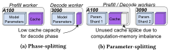

Fig. 1; Section 2.3: Two sources of memory inefficiency

- Phase splitting stores separate model copies and confines decode KV cache to decode workers.
- In the FP16 7B example, a 24 GB 3090 has only about 10 GB left for KV cache.

- Parameter splitting balances compute, but fixes where each request stores its KV cache.
- One GPU can run out of cache while another still has free memory.

> Balancing computation alone does not guarantee usable KV cache capacity.

---

<!-- _class: text-slide dense -->
<!-- SLIDE 04 -->

# Measured GPU Gaps and a Partition Example

Hetis / Background & Motivation

**Table 1.** OPT-2.7B, one iteration through all layers. Prefill batch 3; decode batch 25.

| Device | Memory | Time (Prefill) | Time (Decode) |
| --- | --- | --- | --- |
| A100 | 80 GB | 0.06 s | 0.0097 s |
| 3090 | 24 GB | 0.147 s | 0.0143 s |
| P100 | 12 GB | 1.47 s | 0.077 s |

A100 vs. 3090 / P100: prefill $2.45\times$ / $24.5\times$; decode $1.47\times$ / $7.93\times$; capacity $3.33\times$ / $6.67\times$.

**Section 2.3 example.** Split FP16 OPT-2.7B by decode compute: about 40% of parameters and KV cache on the 3090, 60% on the A100. The 3090 then has at most 18.6 GB for KV cache, while the A100 still has 44.1 GB unused.

> The 10 GB figure on the previous slide is the FP16 7B case, not this 2.7B partition.

Source: Section 2.2, Table 1, and Section 2.3. Ratios are the paper's comparisons of these cells.

---

<!-- _class: figure-wide -->
<!-- SLIDE 05 -->

# MLP and Attention Scale Differently

Hetis / Background & Motivation

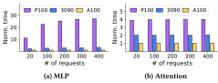

Fig. 2: One Llama-70B decode layer; context length 1000

- The P100/A100 execution-time gap is much larger for MLP than for attention.
- Adding slow GPUs to dense operations can cost more communication than it saves in compute.

- Decode attention has a smaller performance gap and can use otherwise idle GPU memory.
- The preferred GPU partition can differ across modules within the same layer.

> Use selected GPUs for dense work and a wider pool for decode attention.

---

<!-- _class: text-slide math-slide dense -->
<!-- SLIDE 06 -->

# Primary Workers and Attention Workers

Hetis / Methodology

| Operation | Primary workers | Attention workers |
| --- | --- | --- |
| QKV / output projections, MLP | Execute in both phases | No model-weight computation |
| Prefill attention | Execute | Not the offload target |
| Decode attention and KV cache | Retain part of the load | Dynamically share the load |

$$
\text{Attention core}(Q,K,V)=\operatorname{softmax}(QK^\top/\sqrt{d_h})V
$$

Here, the attention core is parameter-free *after* Q, K and V are produced; the projections still require model weights.

> Primary workers remain active in decode; attention offload changes the module placement.

Source: Sections 2.4, 3.2 and 4. Attention core terminology clarified for this presentation.

---

<!-- _class: figure-side -->
<!-- SLIDE 07 -->

# Hetis System Architecture

Hetis / Methodology

- Parallelizer chooses Primary GPUs and their DP / PP / TP configuration.
- Profiler estimates GPU computation and communication cost.
- Dispatcher assigns heads to Primary and Attention workers, and selectively re-dispatches existing requests.
- Hauler manages head-level KV blocks and migrates the required cache shards.

> Offline placement and profiling support online head allocation.

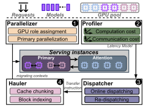

Fig. 3: Parallelizer, Profiler, Dispatcher and Hauler

---

<!-- _class: figure-wide -->
<!-- SLIDE 08 -->

# Hierarchical Search for Primary Parallelism

Hetis / Methodology

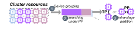

Fig. 4; Section 4.1: Primary worker configuration search

- Form serving instances by dividing each GPU type evenly across instances; filter insufficient cache capacity.
- Initially treat each GPU type as a unified PP stage and balance the maximum stage compute cost.

- Remove low-end GPUs that contribute little to dense computation.
- Explore TP / PP within each stage, then evaluate both computation and communication cost.

> Excluded GPUs become a shared Attention-worker pool, rather than being left unused.

---

<!-- _class: text-slide math-slide -->
<!-- SLIDE 09 -->

# Primary Selection Objective and Pruning Rule

Hetis / Methodology

$$
\sigma^*=\arg\min_{\sigma}C(\sigma,M,\mathcal R),\qquad C=C_{\mathrm{comp}}+C_{\mathrm{comm}}
$$

$\sigma$: parameter placement and DP / PP / TP configuration; $M$: model; $\mathcal R$: workload distribution.

**Remove candidate GPU $\kappa$ from the Primary set if**

$$
\frac{C_p(\sigma-\kappa,M,\mathcal R)}{C_p(\sigma,M,\mathcal R)}\leq1+\Delta,\qquad\Delta=0.05.
$$

- $C_p$ estimates the maximum stage computation cost under ideal scaling; it omits communication at this pruning step.
- Try removals from lower- to higher-end GPU types, then score retained candidates with the fuller cost model.

> A small compute-cost increase can free GPU memory for attention-only service.

Source: Section 4.1, Eq. (1). This hierarchical heuristic does not guarantee global optimality.

---

<!-- _class: figure-wide -->
<!-- SLIDE 10 -->

# Why Split Attention by Head?

Hetis / Methodology

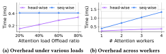

Fig. 5: Llama-70B, 100 Gbps; communication overhead

- Batch-wise splitting moves whole requests, which is coarse when context lengths differ.
- Sequence-wise splitting replicates query vectors across workers holding different token ranges.

- Head-wise splitting transfers only the assigned head vectors and their results.
- Reported communication speedups over sequence splitting: $2.68\times$ at 20% offload; up to $3.55\times$ with four workers.

> Independent heads reduce communication and allow finer cache placement.

---

<!-- _class: text-slide math-slide -->
<!-- SLIDE 11 -->

# Head-wise Attention as Printed

Hetis / Methodology

$$
\mathrm{Attention}_j=\mathrm{Concat}(\mathrm{result}_{1,j},\ldots,\mathrm{result}_{n,j})
$$

$$
\mathrm{result}_{i,j}
    =\operatorname{softmax}\!\left(
      q_{h_i^j(t)}\,K_{h_i^j(t)}^{\top}/\sqrt{d}
    \right)V_{h_i^j(t)}
$$

$h_i^j(t)$: query heads of request $j$ placed on GPU $i$ at time $t$. Each GPU finishes its own heads; outputs are concatenated in head order.

- This is Eq. (2). The earlier attention-core line is the same softmax, without the per-GPU split.
- No cross-GPU softmax reduction is required inside one head.

> Head-wise splitting changes where each head runs, not the attention definition.

Source: Section 4.2, Eq. (2).

---

<!-- _class: figure-wide -->
<!-- SLIDE 12 -->

# Dynamic Attention Placement Across Requests

Hetis / Methodology

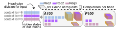

Fig. 6: Three requests, six heads each; context lengths 6, 9 and 3

- Each request can use a different head distribution across the same GPU pool.
- KV cache follows the assigned heads; longer contexts require more cache per head.

- Primary and Attention workers compute their assigned heads, then gather the head outputs.
- Re-dispatching changes selected assignments and migrates only the cache that must move.

> Dynamic parallelism changes placement, not the number of model heads or the attention definition.

---

<!-- _class: text-slide math-slide -->
<!-- SLIDE 13 -->

# Head Integrity and Grouped-Query Attention

Hetis / Methodology

$$
r=\frac{H_Q}{H_{KV}},\qquad \sum_{i=1}^{N_k}x_i^j=H_Q,\qquad x_i^j/r\in\mathbb Z_{\geq0}.
$$

$x_i^j$: query heads of request $j$ assigned to GPU $i$ in pipeline stage $k$.

- MHA: $r=1$; each query head has its own key/value head.
- GQA: each KV head is shared by a group of $r$ query heads; Hetis preserves whole groups.
- Illustrative example: $H_Q=8$, $H_{KV}=2$, so $r=4$; valid per-GPU allocations are 0, 4 or 8 query heads.
- Each assigned head uses its full context. Head-wise computation needs no cross-worker softmax reduction over sequence shards.

> GQA reduces KV volume, but also makes the placement unit coarser than one query head.

Source: Sections 4.2, 5.2.1 and 6. Example is explanatory, not a measured model configuration.

---

<!-- _class: figure-wide -->
<!-- SLIDE 14 -->

# Profiling Decode Attention Time

Hetis / Methodology

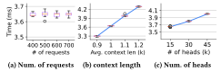

Fig. 7: OPT-30B attention micro-benchmarks

- With total head count and cache size fixed, changing the number of requests has little effect in this test.
- Attention time grows approximately linearly with cache size.

- At a fixed cache size, more query heads also increase execution time.
- These observations motivate a per-GPU affine model using head count and cache amount.

> The model uses the work assigned to a GPU, not request count alone.

---

<!-- _class: text-slide math-slide -->
<!-- SLIDE 15 -->

# Computation and Communication Cost Models

Hetis / Methodology

$$
\tau_i=a_i h_i+b_i g_i+c_i,\qquad \rho_i=\gamma_i d_i+\beta_i,\qquad d_i=(2+2/r)h_i.
$$

- $h_i$: total query heads across requests; $g_i$: associated KV cache amount.
- $a_i,b_i,c_i$: fitted compute coefficients; $\gamma_i,\beta_i$: fitted transfer coefficients.
- Per decode step, remote heads need Q, new K/V and returned attention outputs: $2h_i$ query/output vectors plus $2h_i/r$ KV vectors.
- The expression for $d_i$ counts vectors; head width and bytes per element must be accounted for when using physical byte units.

> Attention-worker cost includes network transfer; retaining work on a Primary GPU avoids that extra transfer.

Source: Section 5.1, Eqs. (3)–(4). Vector-count interpretation makes the units explicit.

---

<!-- _class: text-slide math-slide -->
<!-- SLIDE 16 -->

# Online Dispatch for Newly Arriving Requests

Hetis / Methodology

Keep existing placements fixed; assign only the new requests $\mathcal J(t)$. Define updated load:

$$
\widehat h_i=h_i+\sum_{j\in\mathcal J}x_i^j,\qquad
    \widehat g_i=g_i+\frac{2}{r}\sum_{j\in\mathcal J}\ell_j x_i^j.
$$

$$
\begin{aligned}
    \min_{x,z}\quad &z\\
    \text{s.t.}\quad &f_i(\widehat h_i,\widehat g_i)\leq z,\quad \widehat g_i\leq M_i &&\forall i,\\
    &\sum_{i=1}^{N_k}x_i^j=H_Q,\quad x_i^j/r\in\mathbb Z_{\geq0} &&\forall j\in\mathcal J.
  \end{aligned}
$$

$\ell_j$: current context length; $M_i$: KV capacity. Here $g_i,M_i$ use KV-vector units, with both K and V counted. $f_i$ adds $\rho_i$ for Attention workers.

> Minimize the slowest participant while respecting head completeness and cache capacity.

Consistent restatement of Sections 5.2.1–5.2.2 using Eqs. (6) and (8), not a verbatim Eq. (7).

---

<!-- _class: text-slide math-slide -->
<!-- SLIDE 17 -->

# Printed Dispatch Constraints

Hetis / Methodology

**Eq. (5), all in-service requests $\mathbb S(t)$.** $\displaystyle\sum_{i=1}^{N_k}x_i^j(t)\in\{0,\mathrm H\}$.

**Eq. (6), capacity.** $\displaystyle\sum_{j\in\mathbb S(t)}x_i^j(t)\,l_j(t)\le r\cdot\mathrm M_i(t)/2$.

**Eq. (7), new requests $\mathrm J(t)$ only.**

$$
\min_x\max_i f_i(\vec x_i(t))
$$

$$
g_i(t)+\sum_{j=1}^{|\mathrm J(t)|}x_i^j(t)\,l_j(t)\le\frac{r\cdot\mathrm M_i(t)}{2},
    \qquad
    \sum_{i=1}^{N_k}x_i^j(t)=\mathrm H.
$$

Eq. (5) allows a sum of $0$ or $\mathrm H$. Eq. (7c) requires new requests to sum to $\mathrm H$. The previous slide's $\widehat g_i\le M_i$ form is the reconciled KV-vector version, not this printed (7b).

> Read the printed program and the reconciled LP as two different writings of the same intent.

Source: Section 5.2, Eqs. (5)–(7). $\mathrm H$ is the model's query-head count, written $H_Q$ earlier.

---

<!-- _class: text-slide math-slide -->
<!-- SLIDE 18 -->

# Closed Forms of Attention Time

Hetis / Methodology

**Primary worker** (computation only)

$$
f_i=a_i\Big(h_i+\textstyle\sum_j x_i^j\Big)
    +b_i\Big(g_i+\frac{2}{r}\textstyle\sum_j l_j x_i^j\Big)+c_i
$$

**Attention worker** (computation plus transfer)

$$
f_i=\Big(a_i+\big(2+\tfrac{2}{r}\big)\gamma_i\Big)
    \Big(h_i+\textstyle\sum_j x_i^j\Big)
    +b_i\Big(g_i+\frac{2}{r}\textstyle\sum_j l_j x_i^j\Big)+c_i+\beta_i
$$

Sums run over new requests in $\mathrm J(t)$. The $\gamma_i$ term uses the worker's updated head count, so every decode step transfers Q, K, V and outputs for heads already on that worker.

> These two lines are unnumbered in the paper; they sit in the paragraph after Eq. (7).

Source: Section 5.2.2. Time index $(t)$ is omitted here; the paper writes $h_i(t)$, $g_i(t)$ and $x_i^j(t)$.

---

<!-- _class: text-slide -->
<!-- SLIDE 19 -->

# Dispatch Formulation: What the Paper Specifies

Hetis / Methodology

- With continuous $x_i^j$, the affine cost model and auxiliary variable $z$ give an LP. Hetis reports using CVXPY with MOSEK.
- The required group-integrality constraint $x_i^j/r\in\mathbb Z_{\geq0}$ makes the exact formulation discrete; rounding or an integrality treatment is not described.
- Printed Eq. (7b) mixes existing $g_i$ with query-head-token counts. Eq. (8) and the $f_i$ lines update $g_i$ with a $2/r$ factor.
- The reconciled KV-vector LP is the slide before the printed constraints. Byte-level capacity must also include head width, datatype and the layers stored on a GPU.

> The optimization intent is clear; integer allocation and memory units require care in reproduction.

Source: Sections 5.2 and 6. Formulation caveats are presenter analysis of the supplied PDF.

---

<!-- _class: text-slide math-slide -->
<!-- SLIDE 20 -->

# Re-dispatching to Balance Computation

Hetis / Methodology

**Ideal attention time over existing requests $\mathbb S(t)$:**

$$
f^*=\min\max_i f_i(\vec x_i(t))
    \quad\text{s.t.}\quad
    \sum_{i=1}^{N_k}\sum_{j\in\mathbb S(t)}x_i^j(t)\,l_j(t)
    \le\sum_{i=1}^{N_k}\frac{r\cdot\mathrm M_i}{2}.
$$

- If the deviation from the current attention time exceeds $\Theta$ (default 50%), pick the slowest GPU and its heaviest request.
- Re-dispatch that request with Eq. (7). Keep reusable KV shards; transfer only changed assignments.
- The displayed constraint is one cluster-wide sum. The paper does not define how ``deviation'' is normalized.

> Growing contexts can create stragglers even if initial head placement was balanced.

Source: Section 5.3.1. Head-integrity constraints are not restated in this $f^*$ display.

---

<!-- _class: text-slide -->
<!-- SLIDE 21 -->

# Re-dispatching to Relieve KV Cache Exhaustion

Hetis / Methodology

- A globally selected LIFO / LRU victim may hold no cache on the exhausted GPU.
- Restrict victim selection to requests occupying the overloaded device; the paper adapts LIFO to that device.
- Try redistribution when $\sum_i g_i(t)<\sum_i r\cdot\mathrm M_i/2$; otherwise the cluster has no aggregate free cache under the paper's units.
- Repeat subject to remaining cache capacity and the computation-imbalance threshold; reuse heads whose placement is unchanged.

> Target the actual memory bottleneck and migrate only the necessary KV shards.

Source: Section 5.3.2. Aggregate free capacity alone does not guarantee a feasible discrete allocation.

---

<!-- _class: text-slide -->
<!-- SLIDE 22 -->

# Head-Level KV Management and Migration

Hetis / Methodology

CACHE LAYOUT

## Split blocks along the head dimension

Extend vLLM's fixed-sized blocks; index by sequence ID, token position and head ID.

ATTENTION KERNEL

## Reuse PagedAttention

Compute local heads independently; accelerate block indexing with CPU cores.

COMMUNICATION

## NCCL point-to-point groups

Transfer head-specific inputs and results between Primary and Attention workers.

LIVE MIGRATION

## Low-priority CUDA streams

Reduce interference with ongoing inference communication; bandwidth cost still exists.

> Fine-grained placement requires matching cache indexing, kernels and transfer support.

Source: Section 6. Low-priority migration is not a guarantee of zero overhead.

---

<!-- _class: text-slide -->
<!-- SLIDE 23 -->

# Hetis Experimental Setup

Hetis / Experimental Results

CLUSTER

## 12 GPUs across four hosts

One host with 4 A100-80GB; two hosts with 2 RTX 3090 each; one host with 4 P100.

NETWORK

## 100 Gbps LAN; intra-host PCIe

A local heterogeneous cluster, rather than a cloud-rental cost comparison.

MODELS

## MHA and GQA

Llama-13B and OPT-30B use MHA; Llama-70B uses GQA in the evaluation.

WORKLOADS

## SG / HE / LB

ShareGPT: chatbot; HumanEval: code completion; LongBench: long-article summarization.

> Compare Hetis with Splitwise and HexGen under the paper's specified deployments.

Source: Section 7.1. Table 1 lists 3090 with 24 GB and P100 with 12 GB.

---

<!-- _class: text-slide -->
<!-- SLIDE 24 -->

# Baselines and Evaluation Metrics

Hetis / Experimental Results

- **Llama-70B deployment:** Hetis selects A100 / 3090 as Primary workers and P100 as Attention workers.
- **HexGen:** asymmetric parameter splitting with PP across GPU types and TP within stages.
- **Splitwise:** authors configure A100 TP=4 for prefill; decode uses two PP stages with TP=2 on 3090 and P100.
- **Figures 8–10:** normalized E2E latency in s/token vs. offered request rate. A later sharp rise indicates greater load tolerance.
- **Figures 12–13:** P95 latency normalized to Hetis, which is 1.0. These are ratios, unlike the s/token axes above.

> Keep deployment assumptions and normalization conventions explicit when interpreting speedups.

Source: Section 7.2. No fixed SLO goodput threshold or exact E2E normalization formula is specified.

---

<!-- _class: figure-wide -->
<!-- SLIDE 25 -->

# Llama-13B: Latency Under Increasing Load

Hetis / Experimental Results

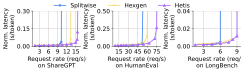

Fig. 8: SG / HE / LB; normalized E2E latency in s/token

- Compare methods within each dataset at the same offered request rate.
- Hetis delays the sharp latency increase across all three workload curves.

- The saturation points differ by dataset; each panel has its own axis scale.
- The advantage is most visible as load increases and compute or cache capacity becomes limiting.

> The figure supports higher sustainable load, not a universal per-request latency ratio.

---

<!-- _class: figure-wide -->
<!-- SLIDE 26 -->

# OPT-30B: Latency Under Increasing Load

Hetis / Experimental Results

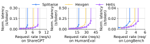

Fig. 9: OPT-30B (MHA), three workload families

- Hetis also delays the rapid latency increase for the larger MHA model.
- With larger model weights, placement determines how much capacity remains for KV cache.

- Head allocation can use memory that static compute-based partitioning leaves underutilized.
- Compare curves at matched load; do not compare raw heights across different dataset panels.

> The benefit persists for OPT-30B in the evaluated heterogeneous cluster.

---

<!-- _class: figure-wide -->
<!-- SLIDE 27 -->

# Llama-70B: GQA End-to-End Results

Hetis / Experimental Results

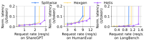

Fig. 10: Llama-70B; Section 7.2 summarizes Figures 8–10

- Hetis retains the advantage with a GQA model, whose KV cache per query head is smaller.
- A100 / 3090 handle dense work; P100 contributes decode attention and cache capacity.

- Across the end-to-end experiments, reported throughput gains are up to $2.25\times$ vs. Splitwise and $1.33\times$ vs. HexGen.
- These maxima summarize the experiments; they are not guaranteed for every panel or workload.

> Module placement and dynamic attention sharing remain useful with GQA.

---

<!-- _class: figure-wide -->
<!-- SLIDE 28 -->

# Maximum Usable KV Cache Space

Hetis / Experimental Results

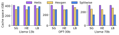

Fig. 11: Maximum available KV cache during inference

- Hetis reports up to $1.87\times$ more usable KV cache capacity than the baselines.
- It avoids storing full model copies on attention-only workers.

- Dynamic allocation reduces the idle cache caused by fixed compute-based partitions.
- The gain is usable cache capacity, not additional physical GPU memory or a guaranteed equal throughput gain.

> More usable cache allows the system to host more concurrent request state.

---

<!-- _class: figure-wide -->
<!-- SLIDE 29 -->

# P95 TTFT and TPOT on Llama-70B

Hetis / Experimental Results

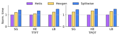

Fig. 12: SG 1.5 req/s; HE 6 req/s; LB 0.8 req/s

- All baselines are below saturation at these selected request rates.
- P95 TTFT ratio: up to $1.22\times$ vs. HexGen and $1.47\times$ vs. Splitwise.

- P95 TPOT ratio: up to $1.39\times$ over the baselines.
- Primary selection helps prefill; avoiding slow dense execution and sharing attention help decode.

> The tail-latency comparison tests unsaturated operation, beyond maximum load capacity.

---

<!-- _class: figure-wide -->
<!-- SLIDE 30 -->

# MLP and Attention Contributions to Decode Latency

Hetis / Experimental Results

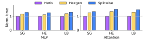

Fig. 13: Llama-70B; the same request rates as Fig. 12

- MLP P95 latency improves by up to $1.29\times$; attention by up to $1.49\times$.
- Dense and attention modules use different placement decisions.

- For this experiment, module latency is the maximum stage time multiplied by the number of PP stages.
- The $1.49\times$ is a module-level result here; it should not be relabeled as a universal E2E speedup.

> Selective dense parallelism and dynamic attention sharing contribute separately.

---

<!-- _class: figure-wide -->
<!-- SLIDE 31 -->

# Dynamic Head and Cache Allocation

Hetis / Experimental Results

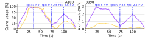

Fig. 14: Llama-13B; one A100 Primary + two 3090 Attention GPUs

- ShareGPT arrival rate changes over time: $5\rightarrow0\rightarrow2.5\rightarrow0$ req/s.
- A100 processes more heads, while both GPU types can reach high cache utilization.

- 3090 participation starts later under light load because remote execution adds communication cost.
- The head counts and cache usage change with both arrivals and completion of ongoing requests.

> Hetis activates remote attention when its compute and memory benefits justify communication.

---

<!-- _class: figure-wide -->
<!-- SLIDE 32 -->

# Re-dispatching Benefits and Cache Operation Costs

Hetis / Experimental Results

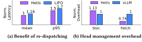

Fig. 15: Re-dispatching vs. LIFO; head management vs. vLLM

- ShareGPT at 5 req/s: re-dispatching improves output latency relative to LIFO.
- P95 ratio is about $1.14\times$; mean ratio is inconsistent: text $1.06\times$, plotted bars $1.16\times$.

- Head-wise cache storage-operation overhead rises by 13%; fetching time falls by 26%.
- The 13% is not 13% more KV bytes: the paper states equal KV memory consumption.

> Re-dispatching has benefits and implementation costs; preserve the metric and comparison.

---

<!-- _class: figure-wide -->
<!-- SLIDE 33 -->

# Sensitivity to Threshold and Profiling Error

Hetis / Experimental Results

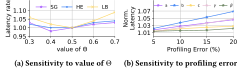

Fig. 16: Re-dispatch threshold and fitted-model perturbations

- Default $\Theta=0.5$ balances migration frequency against computation imbalance.
- Smaller thresholds can migrate too often; larger thresholds can leave stragglers uncorrected.

- Perturbing fitted coefficients by up to $\pm20\%$ raises per-token latency by at most 6.9% in the reported tests.
- This evaluates model-coefficient error, not all network failures or workload shifts.

> The tested sensitivity is moderate; it is not a general robustness guarantee.

---

<!-- _class: text-slide dense -->
<!-- SLIDE 34 -->

# Planning and Profiling Overhead

Hetis / Experimental Results

| Component | Setting | Reported result |
| --- | --- | --- |
| Primary placement search | Local heterogeneous cluster | 4 seconds |
| Larger placement search | Simulation: 5 types $\times$ 32 GPUs | 15 seconds |
| Profiling samples | 8 head counts $\times$ 8 cache amounts | Typically $\leq100$ ms per configuration |
| Transfer model accuracy | Profiled settings | 92.4–96.1% |

- Placement search runs before initial deployment; the 160-GPU result is a simulation.
- Computation-model accuracy is reported as up to 93.8%, without a precise accuracy formula.
- These timings do not establish the latency distribution of the online dispatch solver.

> Separate one-time planning cost, per-sample profiling cost and online scheduling overhead.

Source: Section 7.4.

---

<!-- _class: text-slide -->
<!-- SLIDE 35 -->

# Hetis: Scope and Open Questions

Hetis / Discussion

- **Granularity:** GQA groups restrict how finely heads and memory can be divided; integer handling is underspecified.
- **Network:** repeated per-layer input/result transfers and occasional KV migration may behave differently on slower or congested links.
- **Evidence:** end-to-end tests use a local 12-GPU cluster; the larger-scale result measures simulated placement search.
- **Reproduction:** memory-unit conventions, E2E normalization and online solver latency need more detail.

> Research question: how should head placement change when memory capacity grows faster than memory bandwidth?

Presenter analysis based on Sections 4–7; the research question is not evaluated in Hetis.

---

<!-- _class: text-slide -->
<!-- SLIDE 36 -->

# Hetis: Main Contributions and Findings

Hetis / Conclusion

- **Primary parallelism:** select GPUs and DP / PP / TP configurations for dense work, including execution through both inference phases.
- **Dynamic attention:** assign whole head groups per request across Primary and Attention workers using compute, network and cache models.
- **Runtime support:** selectively re-dispatch growing requests and migrate only necessary head-level KV shards.
- **Reported results:** throughput up to $2.25\times$ vs. Splitwise and $1.33\times$ vs. HexGen; usable KV capacity up to $1.87\times$.

> Different modules need different GPU partitions, and attention placement should adapt online.

Source: Sections 3–7 and 9. Ratios are maxima in the evaluated settings.

---

<!-- _class: text-slide dense -->
<!-- SLIDE 37 -->

# ThunderServe vs. Hetis: Design Choices

Cross-paper Comparison

| **Dimension** | **ThunderServe** | **Hetis** |
| --- | --- | --- |
| Granularity | Prefill / decode phases | Dense modules / attention heads |
| Workers | Phase-specific model replicas | Primary and Attention workers |
| Search | Tabu search + lower-level selection | Primary search + head dispatch |
| Runtime changes | Phase roles and routing | Head allocation / redispatch |
| Data movement | Inter-replica KV transfer | Per-layer Q/K/V/results; KV migration |
| Metrics | SLO attainment, throughput | E2E s/token, P95, usable KV, request rate |

> ThunderServe and Hetis are not compared head-to-head in these papers.

Sources: ThunderServe Sections 3–5; Hetis Sections 4–7.

---

<!-- _class: text-slide -->
<!-- SLIDE 38 -->

# Implications for GPU + HBM / HBF Co-design

Cross-paper / Research Directions

QUESTION 1

## Memory-aware placement

How do HBM bandwidth and capacity alter phase or head assignment?

QUESTION 2

## Tiered KV caches

Could a slower, larger tier improve capacity without hurting TPOT?

QUESTION 3

## Serving simulation

What hardware-model extensions are needed in LLMServingSim?

> These are follow-up research hypotheses, not evaluated HBF results in either paper.

Discussion focus: scheduling policy, cost-model fidelity, and memory hierarchy.

---

<!-- _class: closing -->
<!-- SLIDE 39 -->

# Questions & Discussion

## GPU heterogeneity / KV cache / HBM–HBF

ThunderServe (phase level) vs. Hetis (head level)
