<!-- _class: cover -->
<!-- SLIDE 01 -->

Research meeting

# ThunderServe: Heterogeneous GPU-Aware LLM Serving

## Phase-Level Deployment in Heterogeneous Clouds

Yu-Jui Liang

Advisor: Hsiang-Yun Cheng

National Taiwan University | 21 Oct 2026

---

<!-- _class: text-slide -->
<!-- SLIDE 02 -->

# Presentation Roadmap

ThunderServe / Overview

1. **Background / Motivation** GPU capabilities, inference phases and network heterogeneity.
2. **Methodology** Deployment search, replica orchestration and runtime adaptation.
3. **Experimental Results** SLO attainment, throughput, ablations and model validation.
4. **Discussion / Conclusion** Scope, open questions and main findings.

Source: arXiv:2502.09334 (ThunderServe).

---

<!-- _class: figure-wide -->
<!-- SLIDE 03 -->

# Prefill and Decode Have Different Bottlenecks

ThunderServe / Background & Motivation

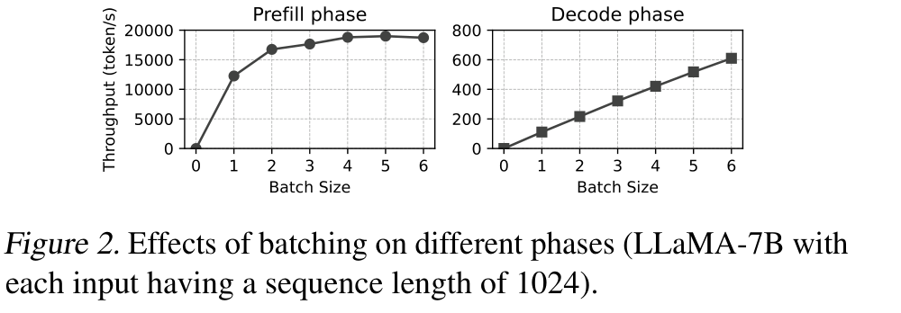

Fig. 2: LLaMA-7B; 1024 input tokens per request

- **Prefill:** process the prompt, build KV cache and generate the first token.
- In this test, token throughput soon saturates as batch size grows.

- **Decode:** reuse KV cache and generate one new token per step.
- Batching amortizes weight reads and improves decode throughput.

> Prefill is usually compute-bound; decode is often memory-bandwidth-bound.

---

<!-- _class: figure-wide -->
<!-- SLIDE 04 -->

# Different GPUs Favor Different Inference Phases

ThunderServe / Background & Motivation

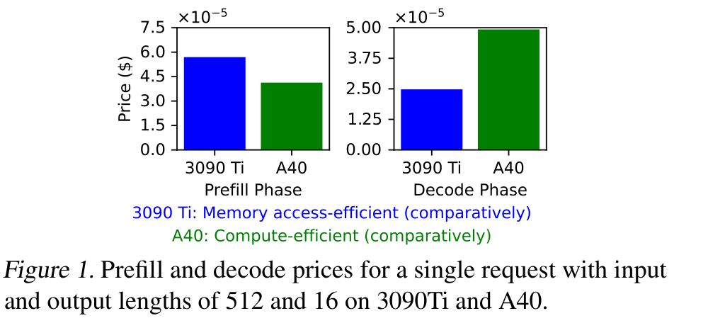

Fig. 1: Per-request cost; input 512 / output 16 tokens

- A40 has lower prefill cost in this experiment.
- Its compute capability favors prompt processing.

- 3090 Ti has lower decode cost in this experiment.
- Its higher memory bandwidth favors token generation.

> Choose GPUs by phase, workload and rental cost, rather than a single GPU ranking.

---

<!-- _class: text-slide dense -->
<!-- SLIDE 05 -->

# GPU Specifications in Table 1

ThunderServe / Background & Motivation

| GPU | Memory bandwidth | Peak FP16 | Memory | Price / GPU |
| --- | --- | --- | --- | --- |
| A100 | 2 TB/s | 312 TFLOPS | 80 GB | &#36;1.753/hr |
| A6000 | 768 GB/s | 38.7 TFLOPS | 48 GB | &#36;0.483/hr |
| A5000 | 626.8 GB/s | 27.8 TFLOPS | 24 GB | &#36;0.223/hr |
| A40 | 696 GB/s | 149.7 TFLOPS | 48 GB | &#36;0.403/hr |
| 3090Ti | 1008 GB/s | 71 TFLOPS | 24 GB | &#36;0.307/hr |

A40's 149.7 TFLOPS is the compute side of the previous cost figure; 3090Ti's 1008 GB/s is the memory-bandwidth side. Eight A100s at &#36;1.753/hr match the later &#36;14.024/hr in-house budget.

> Use these per-GPU numbers for capability; Section 5.1's &#36;13.542/hr is the rented 32-GPU bundle, not the sum of this column.

Source: Table 1 and Section 5.1.

---

<!-- _class: figure-side -->
<!-- SLIDE 06 -->

# Cloud Networking Is Highly Heterogeneous

ThunderServe / Background & Motivation

- Left: 32 cloud GPUs have uneven connectivity across GPU pairs.
- Right: 8 in-house A100 GPUs have much faster links; color scales differ.
- Phase splitting adds a transfer of prompt KV cache between replicas.
- Low-bandwidth paths can erase the benefit of specializing GPUs by phase.

> Deployment must account for both GPU capability and the communication topology.

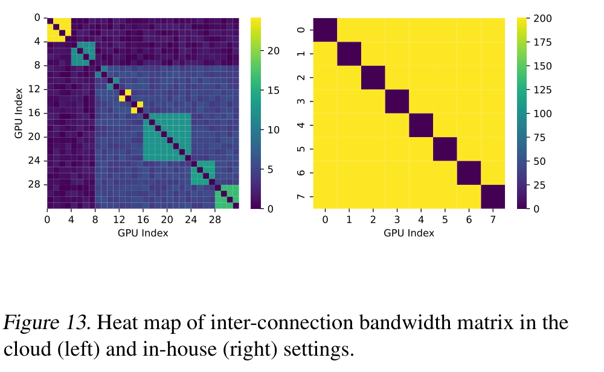

Fig. 13: Pairwise bandwidth measured with NCCL

---

<!-- _class: text-slide -->
<!-- SLIDE 07 -->

# Three Challenges for Phase Splitting in Clouds

ThunderServe / Background & Motivation

1. **Limited, heterogeneous GPU inventory**  Group available GPUs into replicas and assign each replica a phase.
2. **Slow, heterogeneous network links**  Account for TP / PP communication and the extra KV cache transfer.
3. **Changing workloads and GPU availability**  Adjust resource allocation without repeatedly reloading model weights.

> ThunderServe jointly plans deployment and routing, then adapts the running service.

Source: Introduction, challenges 1–3.

---

<!-- _class: figure-side -->
<!-- SLIDE 08 -->

# ThunderServe: System Overview

ThunderServe / Methodology

- The scheduler inputs model configuration, workload patterns, GPU types and bandwidth matrix.
- The workload profiler monitors average prompt and output lengths.
- The task coordinator dispatches requests across prefill and decode replicas.
- Workload shifts or GPU heartbeat timeouts trigger lightweight re-scheduling.

> The deployment plan links scheduling decisions to online request dispatching.

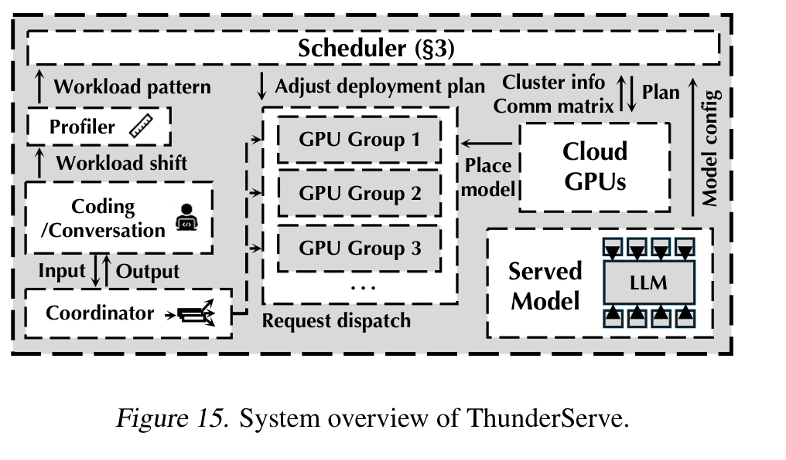

Fig. 15: Scheduler, workload profiler, task coordinator

---

<!-- _class: text-slide -->
<!-- SLIDE 09 -->

# A Deployment Plan Has Four Components

ThunderServe / Methodology

1 / GROUP CONSTRUCTION

## Model serving groups

Partition available GPUs into groups; each group serves one model replica.

2 / PHASE DESIGNATION

## Prefill or decode

Specify which inference phase each model serving group serves.

3 / PARALLEL CONFIGURATION

## Parallelism strategies

Determine tensor and pipeline model parallelism for each replica.

4 / ORCHESTRATION

## Request routing

Determine how requests are routed through prefill and decode replicas.

> Upper-level: group construction + phase designation; lower-level: parallel configuration + orchestration.

Source: ThunderServe, Section 3.1 and Figure 3.

---

<!-- _class: figure-wide -->
<!-- SLIDE 10 -->

# Scheduling as Two-Level Hierarchical Optimization

ThunderServe / Methodology

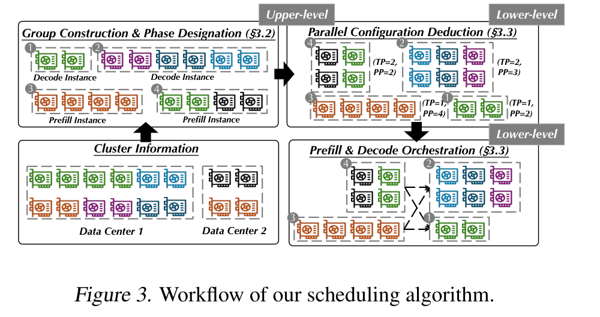

Fig. 3: Workflow of the scheduling algorithm

- Upper-level optimizes group construction and phase designation.
- Lower-level optimizes parallel configuration and replica orchestration.

- Given a candidate upper-level solution, the lower-level returns its SLO attainment.
- The upper-level search uses that performance feedback to improve the deployment plan.

> Objective: maximize the fraction of requests meeting the end-to-end latency deadline.

---

<!-- _class: text-slide -->
<!-- SLIDE 11 -->

# Initialization and Feasibility in Tabu Search

ThunderServe / Methodology

INITIAL SOLUTION

## Hierarchical Clustering

Cluster GPUs based on their inter-connection bandwidth matrix; treat each cluster as a model serving group.

PHASE DESIGNATION

## Random initialization

Randomly assign the initial prefill / decode phase of each group.

EARLY CHECK

## GPU memory limit

Eliminate a neighbor if any serving group cannot store one copy of the model parameters.

SEARCH COMPLEXITY

## Combinatorial search

The paper motivates tabu search via a JSSP analogy (Appendix A); the search is heuristic.

> Bandwidth-aware initialization and memory pruning reduce wasted search.

Source: Section 3.2, Algorithm 1, Appendix A.

---

<!-- _class: figure-wide -->
<!-- SLIDE 12 -->

# Four Neighbor Operations in Tabu Search

ThunderServe / Methodology

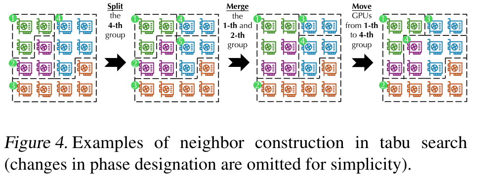

Fig. 4: Neighbor construction in tabu search

- **Flip:** change a serving group's prefill or decode phase.
- **Split:** divide one GPU group into two.

- **Merge:** combine two GPU groups.
- **Move:** transfer GPUs of a given type between groups.

> Tabu search explores changes in both GPU grouping and phase designation.

---

<!-- _class: text-slide math-slide -->
<!-- SLIDE 13 -->

# Neighbor Updates in Notation

ThunderServe / Methodology

$g_{i,t}$: number of type-$t$ GPUs in group $i$, with types $t\in\{1,\ldots,T\}$. Flip only changes a group's phase and has no $g$ update.

**Split** group $s$ by a random ratio $r$:

$$
g_{s'_1,t}\leftarrow\lfloor g_{s,t}\times r\rfloor,\qquad
    g_{s'_2,t}\leftarrow g_{s,t}-g_{s'_1,t}.
$$

**Merge** groups $i$ and $j$: $g'_{\mathrm{merged},t}\leftarrow g_{i,t}+g_{j,t}$.

**Move** $m_t$ GPUs of type $t$ from $i$ to $j$:

$$
g'_{i,t}\leftarrow g_{i,t}-m_t,\qquad g'_{j,t}\leftarrow g_{j,t}+m_t.
$$

New groups from split or merge receive a random phase. A neighbor is dropped if some group cannot store one model copy.

> These three updates are the grouping half of the four neighbor operations.

Source: Section 3.2. The formulas are unnumbered in the paper.

---

<!-- _class: algorithm -->
<!-- SLIDE 14 -->

# Tabu Search: Evaluation and Update

ThunderServe / Methodology

**Algorithm 1: Upper-level tabu search**

|  |  |
| --- | --- |
| 1: | **function** TabuSearch($N_{\mathrm{step}}=100$, $N_{\mathrm{nghb}}=10$, $N_{\mathrm{mem}}=5$): |
| 2: | &emsp;Initialize the current solution $x$ |
| 3: | &emsp;Initialize tabu list $T\leftarrow[\,]$, best solution $x_{\mathrm{best}}\leftarrow x$ |
| 4: | &emsp; */\* Iterative Neighborhood Search \*/* |
| 5: | &emsp;**for** $N_{\mathrm{step}}$ search steps **do** |
| 6: | &emsp;&emsp;Construct $N_{\mathrm{nghb}}$ neighbors of $x$ and exclude those in $T$ to form the neighborhood set $\mathcal N$ for navigation |
| 7: | &emsp;&emsp;$x'\leftarrow\arg\max_{x''\in\mathcal N}f(x'')$ |
| 8: | &emsp;&emsp;**if** $f(x')>f(x_{\mathrm{best}})$ **then** $x_{\mathrm{best}}\leftarrow x'$ |
| 9: | &emsp;&emsp;$T.\operatorname{append}(x')$ |
| 10: | &emsp;&emsp;**if** $\operatorname{len}(T)>N_{\mathrm{mem}}$ **then** $T\leftarrow T[-N_{\mathrm{mem}}:]$ |
| 11: | &emsp;&emsp;$x\leftarrow x'$ |
| 12: | &emsp;**end for** |
| 13: | &emsp;**return** $x_{\mathrm{best}}$ |
| 14: | **end function** |

$x$: GPU grouping + phase roles; $f(x)$: SLO attainment from the lower-level problem; $T$: tabu list.

Source: Algorithm 1, Section 3.2, PDF p. 5. Transcribed with original line numbers; notation typeset for slides.

---

<!-- _class: text-slide -->
<!-- SLIDE 15 -->

# Deducing Parallel Configurations for Each Group

ThunderServe / Methodology

TENSOR MODEL PARALLELISM

## TP: split work within layers

Disallow cross-node TP; Appendix B additionally limits TP to GPUs of a single type.

PIPELINE MODEL PARALLELISM

## PP: split layers into stages

Account for different GPU memory capacities and computing abilities.

PIPELINE ROUTING

## Dynamic programming

Identify pipeline communication paths that minimize cross-stage communication cost.

PARALLEL CONFIGURATION

## Phase-specific objective

Select the lowest predicted latency for prefill; highest predicted throughput for decode among candidates.

> Deduce each group's parallel configuration before prefill / decode orchestration.

Source: Section 3.3 and Appendix B; cost model from HexGen.

---

<!-- _class: algorithm full-algorithm -->
<!-- SLIDE 16 -->

# Algorithm 2: Parallel Configuration Search (1/2)

ThunderServe / Methodology

|  |  |
| --- | --- |
| 1: | **Initialize:** group formation $G=\{G_1,G_2,\ldots,G_g\}$, minimum number of single-type GPUs in the group $T=\{T_1,T_2,\ldots,T_g\}$, cluster information $I$, model configuration $M$ |
| 2: | $\mathrm{model\_parallel\_configurations}\leftarrow[\,]$ |
| 3: | **for** $i$ in $\operatorname{len}(G)$ **do** |
| 4: | &emsp;$\mathrm{plan\_list}\leftarrow[\,]$ |
| 5: | &emsp;*/\* Limit TP within Single-type GPUs \*/* |
| 6: | &emsp;**for** $TP\in\{1,2,\ldots,T_i\}$ **do** |
| 7: | &emsp;&emsp;**for** $PP\in\{1,2,\ldots,G_i.\mathrm{num\_gpus}/T_i\}$ **do** |
| 8: | &emsp;&emsp;&emsp;*/\* Route Pipeline Communication \*/* |
| 9: | &emsp;&emsp;&emsp;$\mathrm{plan}\leftarrow\mathrm{Dynamic\_Programming}(I,TP,PP)$ |
| 10: | &emsp;&emsp;&emsp;*/\* Generate Pipeline Partition \*/* |
| 11: | &emsp;&emsp;&emsp;$\mathrm{plan}\leftarrow\mathrm{Pipeline\_Partition}(M,\mathrm{plan})$ |
| 12: | &emsp;&emsp;&emsp;**if** $G_i.\mathrm{type}$ is prefill **then** |
| 13: | &emsp;&emsp;&emsp;&emsp;$C\leftarrow\mathrm{latency}(\mathrm{plan})$ |
| 14: | &emsp;&emsp;&emsp;**else** |
| 15: | &emsp;&emsp;&emsp;&emsp;$C\leftarrow\mathrm{throughput}(\mathrm{plan})$ |
| 16: | &emsp;&emsp;&emsp;**end if** |
| 17: | &emsp;&emsp;&emsp;$\mathrm{plan\_list}.\mathrm{append}((C,\mathrm{plan}))$ |

Source: Appendix B, Algorithm 2, PDF p. 13; original lines 1–17. All 29 lines retained across two slides; indentation clarified.

---

<!-- _class: algorithm full-algorithm -->
<!-- SLIDE 17 -->

# Algorithm 2: Parallel Configuration Search (2/2)

ThunderServe / Methodology

|  |  |
| --- | --- |
| 18: | &emsp;&emsp;**end for** |
| 19: | &emsp;**end for** |
| 20: | &emsp;**if** $G_i.\mathrm{type}$ is prefill **then** |
| 21: | &emsp;&emsp;*/\* Select Latency Optimal Plan \*/* |
| 22: | &emsp;&emsp;$\mathrm{plan}\leftarrow\min(C)$ in $\mathrm{plan\_list}$ |
| 23: | &emsp;**else** |
| 24: | &emsp;&emsp;*/\* Select Throughput Optimal Plan \*/* |
| 25: | &emsp;&emsp;$\mathrm{plan}\leftarrow\max(C)$ in $\mathrm{plan\_list}$ |
| 26: | &emsp;**end if** |
| 27: | &emsp;$\mathrm{model\_parallel\_configurations}.\mathrm{append}(\mathrm{plan})$ |
| 28: | **end for** |
| 29: | **return** $\mathrm{model\_parallel\_configurations}$ |

> Lines 18–19 finish PP / TP enumeration; lines 20–27 choose and store one plan for this group.

Lines 22 / 25 select the plan associated with the smallest / largest $C$. Line 28 ends the group loop; line 29 returns all selected configurations.

Source: Appendix B, Algorithm 2, PDF p. 13; original lines 18–29. All 29 lines retained across two slides; indentation clarified.

---

<!-- _class: figure-wide -->
<!-- SLIDE 18 -->

# Orchestrating Prefill and Decode Replicas

ThunderServe / Methodology

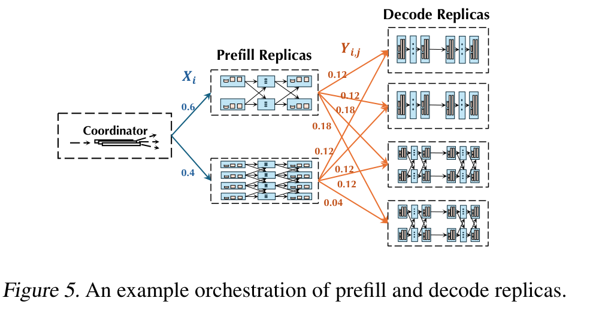

Fig. 5: Example prefill-to-decode orchestration

- A request executes on a prefill replica and then a decode replica.
- KV cache must be transmitted between the two replicas.

- DistServe's inference task simulator estimates pairwise SLO attainment.
- The resulting matrix $D_{ij}$ scores each prefill–decode pair, including KV transfer cost.

> Request routing must account for heterogeneous inter-replica communication.

---

<!-- _class: text-slide math-slide -->
<!-- SLIDE 19 -->

# Modeling KV Cache Communication Cost

ThunderServe / Methodology

**Paper Eq. (1): alpha-beta communication model**

$$
T_{ij}^{(\mathrm{kv\ comm})}=\alpha_{ij}+\frac{2bshN_{\mathrm{bytes}}}{\beta_{ij}}
$$

$b$: batch size; $s$: sequence length; $h$: block hidden size; $N_{\mathrm{bytes}}$: bytes per KV element.  $\alpha_{ij}$: startup latency; $\beta_{ij}$: bandwidth in bytes/s; factor 2: keys and values.

- Transfer time grows with payload size and falls with link bandwidth.
- **Scope note:** the printed equation has no layer-count term.
- For full-model KV cache, tensor accounting gives $V_{\mathrm{KV}}=2Lbs h_{\mathrm{KV}}q$ bytes before metadata ($L$: layers; $h_{\mathrm{KV}}$: total KV-head width; $q$: bytes/element).

> Account for transferred layers, KV heads and sharding when applying the model.

Source: Section 3.3, Eq. (1). Full-model tensor accounting is an explanatory clarification.

---

<!-- _class: text-slide math-slide -->
<!-- SLIDE 20 -->

# Replica Routing Objective and Formulation Caveats

ThunderServe / Methodology

$D_{ij}$: simulated SLO attainment for prefill replica $i$ and decode replica $j$.

$$
\max_{X,Y}\ \sum_{i=1}^{m}\sum_{j=1}^{n} X_iY_{ij}D_{ij}
$$

**Printed constraints:** $\displaystyle\sum_{i=1}^{m}X_i=1$, $\displaystyle\sum_{j=1}^{n}Y_{ij}$ for all $i$, $X_i\ge 0$, $Y_{ij}\ge 0$.

- $X_i$: fraction of incoming requests assigned to prefill $i$. $Y_{ij}$: fraction routed to decode $j$, conditional on prefill $i$.
- The paper calls this a two-stage transportation problem solved by LP.
- **The print is incomplete:** $X_iY_{ij}$ is bilinear, the $Y$ sum has no equality, and capacity constraints are absent.

> The routing idea is clear; the printed equation alone is insufficient to reproduce the LP.

Source: Section 3.3. Caveats are observations on the supplied PDF, p. 6.

---

<!-- _class: figure-wide -->
<!-- SLIDE 21 -->

# Network-Aware Deployment Plans

ThunderServe / Methodology

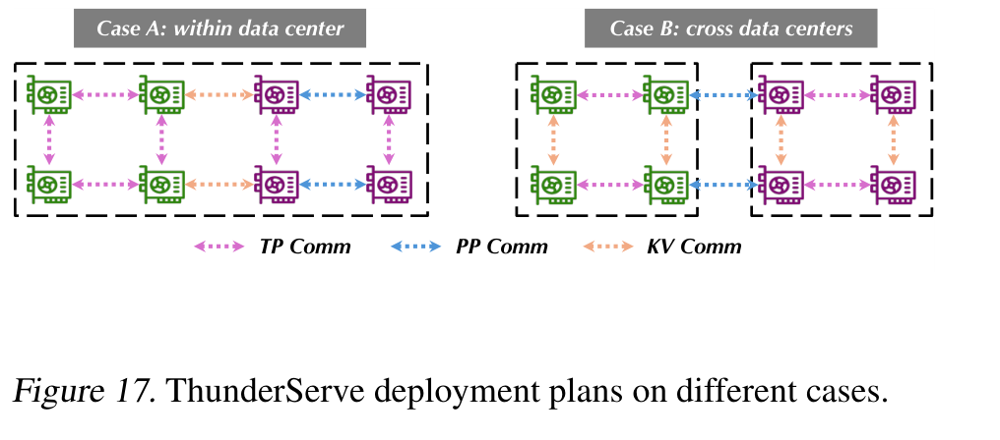

Fig. 17; Appendix H: LLaMA-30B, 4 A40 + 4 3090 Ti

- At 40 Gbps, use 4-A40 for prefill and 4-3090Ti for decode.
- Throughput: 3292 vs. 1610 tokens/s for the non-disaggregating baseline.

- At 5 Gbps, both phases use 2-A40 and 2-3090Ti across instances.
- 2196 tokens/s ($1.4\times$ baseline): KV stays within instances; PP crosses instances.

> The scheduler changes deployment as inter-instance bandwidth changes.

---

<!-- _class: text-slide dense -->
<!-- SLIDE 22 -->

# Request-Time Breakdown in Table 5

ThunderServe / Methodology

LLaMA-30B, 4$\times$A40 + 4$\times$ 3090Ti. High / low are the 40 Gbps and 5 Gbps deployments on the previous slide.

| Configuration | Prefill | KV comm | Decode | Throughput |
| --- | --- | --- | --- | --- |
| Baseline | 884 ms | 0 ms | 1689 ms | 1610 tok/s |
| ThunderServe, 40 Gbps | 698 ms | 133 ms | 1126 ms | 3292 tok/s |
| ThunderServe, 5 Gbps | 964 ms | 41 ms | 1846 ms | 2196 tok/s |

The 5 Gbps row has less KV time because the deployment stops sending KV across instances, not because the slow link is faster.

> Do not invert one request's prefill $+$ decode time and call that system throughput.

Source: Appendix H, Table 5.

---

<!-- _class: figure-side -->
<!-- SLIDE 23 -->

# Throughput Depends on Prefill-to-Decode Ratio

ThunderServe / Methodology

- LLaMA-13B with 8, 12 and 16 A5000 GPUs; two GPUs per replica.
- Ratio means number of prefill replicas to decode replicas.
- Coding requests have longer prompts and shorter outputs, favoring more prefill replicas.
- Conversation requests have shorter prompts and longer outputs, favoring more decode replicas.

> The optimal phase ratio changes with workload and cluster size.

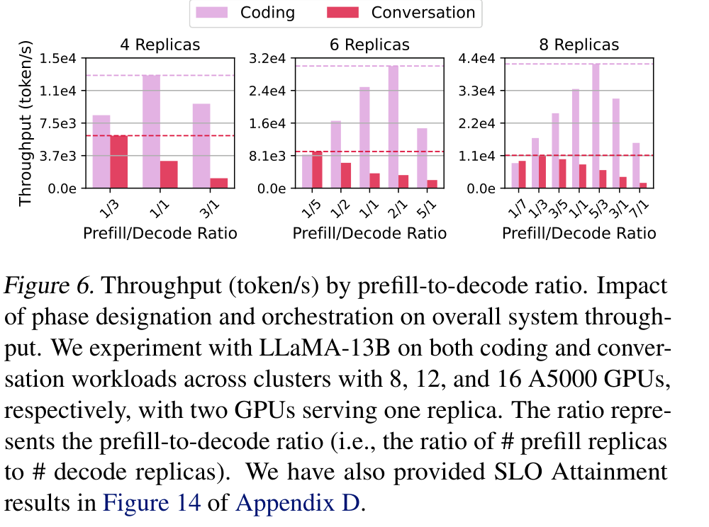

Fig. 6: Throughput vs. phase ratio

---

<!-- _class: figure-side -->
<!-- SLIDE 24 -->

# SLO Attainment Also Depends on Phase Ratio

ThunderServe / Methodology

- LLaMA-13B on 16 A5000 GPUs; two GPUs per replica.
- Coding workload: 5:3 is the reported optimal prefill-to-decode ratio.
- Conversation workload: 3:5 is the reported best ratio.
- More decode replicas help with longer-running decoding.

> Lightweight re-scheduling adjusts phase designation for workload shifts.

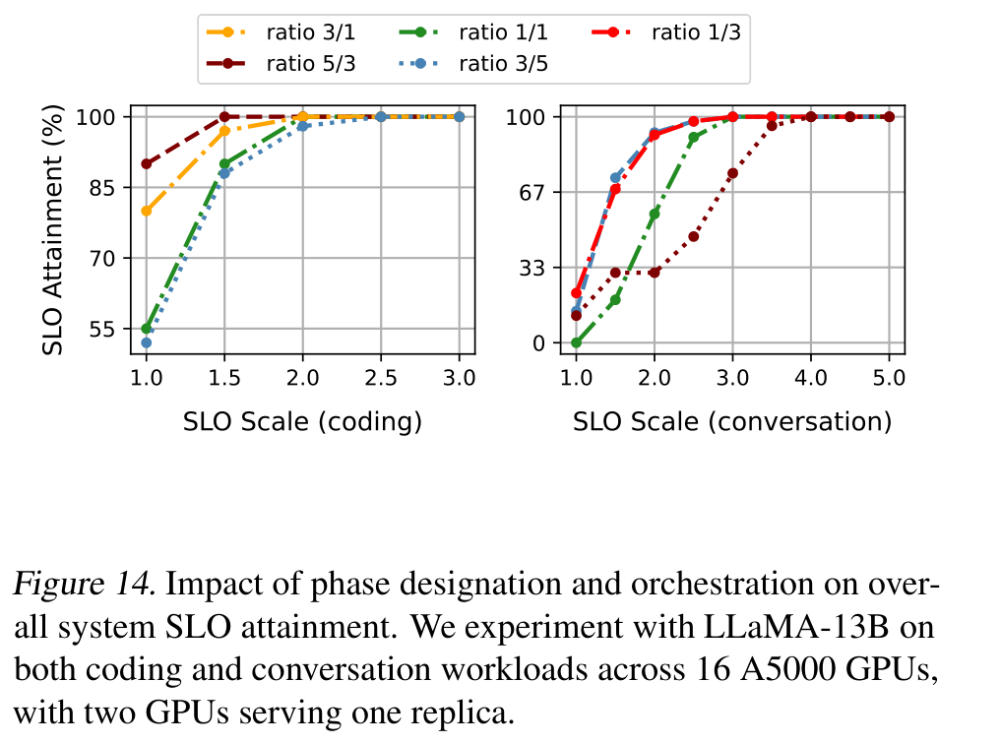

Fig. 14: Phase designation and orchestration (Appendix D)

---

<!-- _class: text-slide -->
<!-- SLIDE 25 -->

# Lightweight Re-scheduling in Real Time

ThunderServe / Methodology

WHY RE-SCHEDULE?

## Workload variability

Workload characteristics and GPU availability change in online cloud services.

TABU SEARCH

## Only flipping phase designation

Do not use splitting, merging or moving groups during lightweight re-scheduling.

PARALLELISM

## Skip new deduction

Keep surviving group construction and existing TP / PP configurations.

ORCHESTRATION

## Solve routing again

Optimize orchestration with updated phase designation; no model-parameter reloading.

> Keeping weights in place saves reload time, but restricts the plans that can be explored.

Source: Section 3.4. Quantitative overhead appears in Table 4.

---

<!-- _class: text-slide -->
<!-- SLIDE 26 -->

# Runtime Support for Phase Splitting

ThunderServe / Methodology

COMMUNICATION SETUP

## Pre-created NCCL group pool

Establish potentially needed communication groups in advance to reduce group-creation overhead.

TRANSFER

## Asynchronous KV communication

Use asynchronous communication to overlap KV transfers with computation.

QUEUE LOCATION

## KV buffers on prefill replicas

Completed prompt KV caches wait in prefill GPU memory.

DECODE SIDE

## Retrieve KV after a decoding round

Decode replicas pull queued KV caches; the deployment plan guides request assignment.

> The runtime implements the plan while managing KV queues and communication overhead.

Source: Section 4 and Appendix E; FlashAttention and PagedAttention are also integrated.

---

<!-- _class: figure-side -->
<!-- SLIDE 27 -->

# Quantize KV Cache for Communication Only

ThunderServe / Methodology

- Quantize and pack 16-bit KV values into 4-bit elements for transfer.
- Decode replica unpacks and dequantizes received KV cache.
- Both prefill and decode computations use 16-bit KV cache.
- LLaMA-7B, two A5000s, 40 Gbps: communication share falls from 16–30% to 4–9%.

> Dequantization restores the 16-bit representation, not the information lost in quantization.

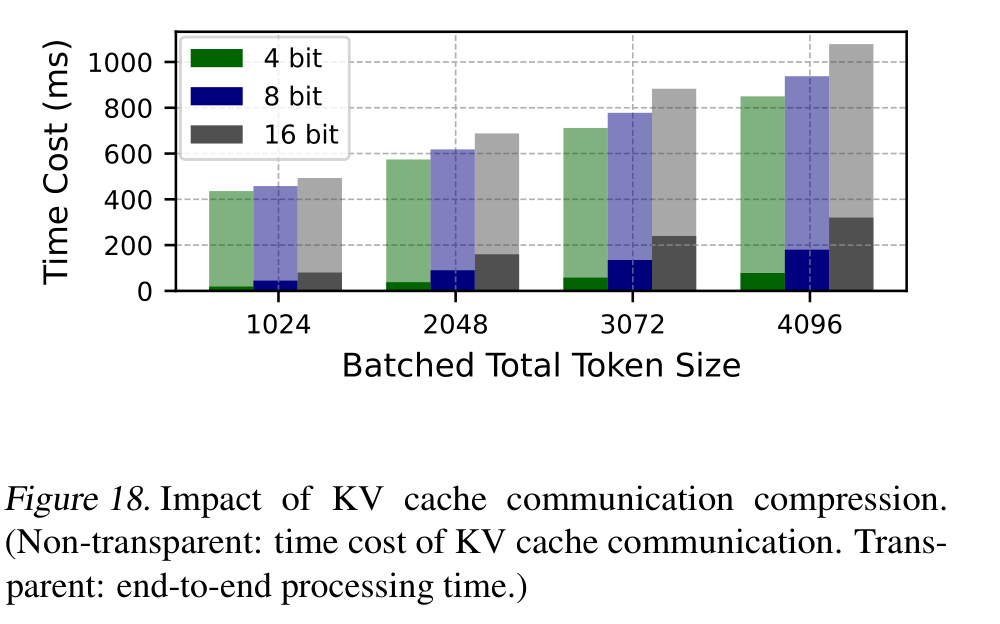

Fig. 18: Impact of KV cache communication compression

---

<!-- _class: text-slide dense -->
<!-- SLIDE 28 -->

# KV Compression: Speed and Model Quality

ThunderServe / Experimental Evidence

**LLaMA-30B, Appendix H setup (Table 8)**

| Precision | Prefill | KV transfer | Decode | Throughput |
| --- | --- | --- | --- | --- |
| 16-bit | 684 ms | 584 ms | 1108 ms | 2450 tok/s |
| 4-bit | 698 ms | 133 ms | 1126 ms | 3292 tok/s ($1.34\times$) |

- Table 2: largest observed task-score drop is GSM8K / LLaMA-13B, $22.34\rightarrow21.29$ (1.05 percentage points; about 4.7% relative).
- Tables 6–7: PPL changes by less than 1%; ROUGE against 16-bit outputs ranges from 0.911 to 0.975 in these tests.

> The tested quality changes are small in absolute terms, but compression is lossy.

Source: Table 2 and Appendix I, Tables 6–8. Relative changes calculated from table values.

---

<!-- _class: text-slide dense -->
<!-- SLIDE 29 -->

# Task Scores under 4-bit KV Transfer

ThunderServe / Experimental Evidence

**Table 2.** CoQA, TruthfulQA and GSM8K. Scores are task accuracy, not latency.

| Task | Precision | LLaMA-7B | LLaMA-13B |
| --- | --- | --- | --- |
| CoQA | 16-bit / 4-bit | 63.95 / 64.58 | 66.35 / 66.54 |
| TruthfulQA | 16-bit / 4-bit | 30.64 / 30.13 | 29.68 / 29.34 |
| GSM8K | 16-bit / 4-bit | 13.23 / 12.54 | 22.34 / 21.29 |

CoQA rises slightly. The largest absolute drop is GSM8K / 13B, $22.34\to 21.29$ (1.05 points, about 4.7% relative). GSM8K / 7B drops about 5.2% relative.

> ``Below 2%'' in the text matches these absolute point drops, not every relative drop.

Source: Table 2. Relative changes are calculated from the cells.

---

<!-- _class: text-slide dense -->
<!-- SLIDE 30 -->

# PPL and ROUGE under 4-bit KV Transfer

ThunderServe / Experimental Evidence

**Table 6.** PPL, 16-bit / 4-bit. Lower is better.

| Dataset | LLaMA-7B | LLaMA-30B |
| --- | --- | --- |
| WikiText2 | 3.53 / 3.55 | 2.73 / 2.75 |
| PTB | 7.46 / 7.42 | 6.49 / 6.55 |
| CBT | 7.66 / 7.70 | 6.31 / 6.30 |

**Table 7.** ROUGE of 4-bit outputs vs. 16-bit outputs.

| Dataset | Metric | 7B | 30B |
| --- | --- | --- | --- |
| WikiText2 | R-1 / R-2 / R-L | .962/.941/.955 | .942/.928/.941 |
| PTB | R-1 / R-2 / R-L | .975/.950/.971 | .928/.911/.928 |
| CBT | R-1 / R-2 / R-L | .925/.912/.925 | .946/.931/.937 |

PPL changes stay within about 1%. ROUGE spans 0.911 (PTB, 30B, ROUGE-2) to 0.975 (PTB, 7B, ROUGE-1).

> ROUGE here measures agreement with 16-bit outputs, not factual correctness.

Source: Appendix I, Tables 6–7.

---

<!-- _class: text-slide -->
<!-- SLIDE 31 -->

# Experimental Setup and Baselines

ThunderServe / Experimental Results

HETEROGENEOUS CLOUD

## 32 GPUs / &#36;13.542 per hour

Two 4-A6000, two 4-A5000, one 8-A40 and two 4-3090Ti instances (Vast.ai).

HOMOGENEOUS IN-HOUSE

## 8 A100-80GB / &#36;14.024 per hour

A comparable cloud-rental price budget for vLLM and DistServe baselines.

MODEL / WORKLOAD

## LLaMA-30B / Azure Conversation

Coding and conversation workloads; Poisson arrivals with exponential inter-arrival times.

BASELINES / METRICS

## HexGen, vLLM, DistServe

TTFT, TPOT and E2E SLO attainment; system throughput.

> HexGen uses the same cloud hardware; vLLM / DistServe use a similar-price A100 server.

Source: Section 5.1 and Table 1. Prices are the paper's reported rental prices, not current quotes.

---

<!-- _class: text-slide -->
<!-- SLIDE 32 -->

# Reading SLO Attainment and Latency Deadlines

ThunderServe / Experimental Results

- **TTFT:** request arrival to first token; includes waiting and prompt processing.
- **TPOT:** average time per subsequent output token during decoding.
- **E2E latency:** request arrival to completion, including waiting and inter-phase transfer.
- **SLO attainment:** fraction of requests meeting the specified deadline; the paper evaluates TTFT, TPOT and E2E separately.
- **SLO scale:** deadline divided by the A100 execution-latency reference used in the evaluation.

> At the same request rate and target attainment, a curve farther left needs a shorter deadline.

Example: a $2\times$ deadline improvement means $d_{\rm baseline}/d_{\rm ThunderServe}=2$ at the same attainment. It is not a claim about mean latency.

Source: Sections 2 and 5.1.

---

<!-- _class: figure-side -->
<!-- SLIDE 33 -->

# Cloud SLO Attainment: ThunderServe vs. HexGen

ThunderServe / Experimental Results

- ThunderServe improves TTFT, TPOT and E2E SLO attainment over HexGen.
- Compare minimum deadlines at the same arrival rate and target attainment.
- Coding: E2E deadline ratio (HexGen / ThunderServe) up to $1.8\times$; average $1.4\times$.
- Conversation: E2E deadline ratio up to $1.4\times$; average $1.3\times$.

> Phase splitting reduces interference between prefill and decode.

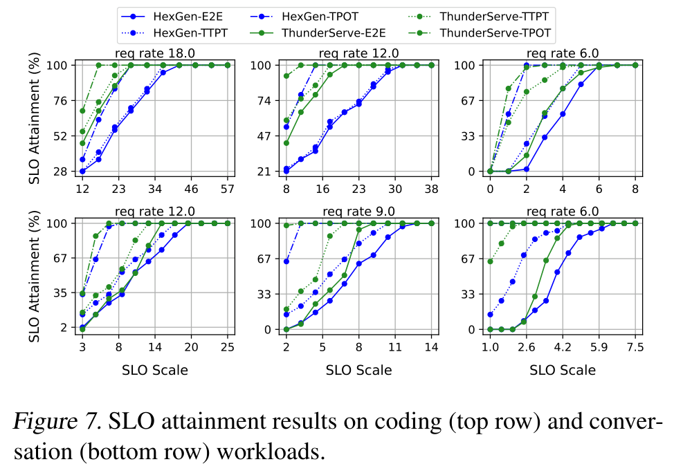

Fig. 7: Coding (top) and conversation (bottom) SLO

---

<!-- _class: figure-side -->
<!-- SLIDE 34 -->

# Cost Efficiency: Cloud vs. In-House

ThunderServe / Experimental Results

- ThunderServe on cloud is compared with DistServe and vLLM on in-house A100 GPUs.
- The total cloud price budget is close to the 8-A100 baseline budget.
- E2E deadline ratio (baseline / ThunderServe): up to $2.5\times$; average $1.8\times$ (Section 5.2).
- 12 cloud phase replicas versus 4 DistServe phase replicas; this is a system-plus-hardware comparison.

> More replicas and heterogeneity-aware scheduling improve cost efficiency.

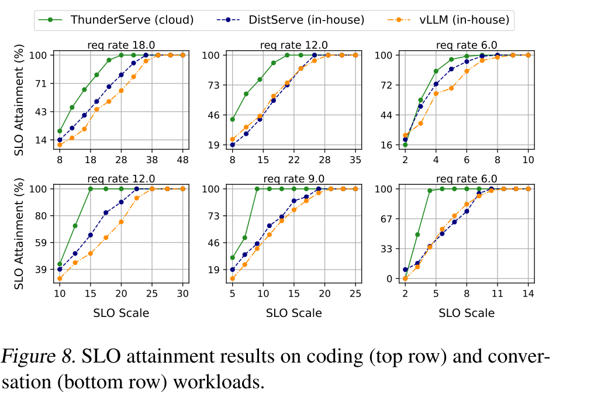

Fig. 8: SLO attainment under similar price budgets

---

<!-- _class: figure-wide -->
<!-- SLIDE 35 -->

# End-to-End System Throughput

ThunderServe / Experimental Results

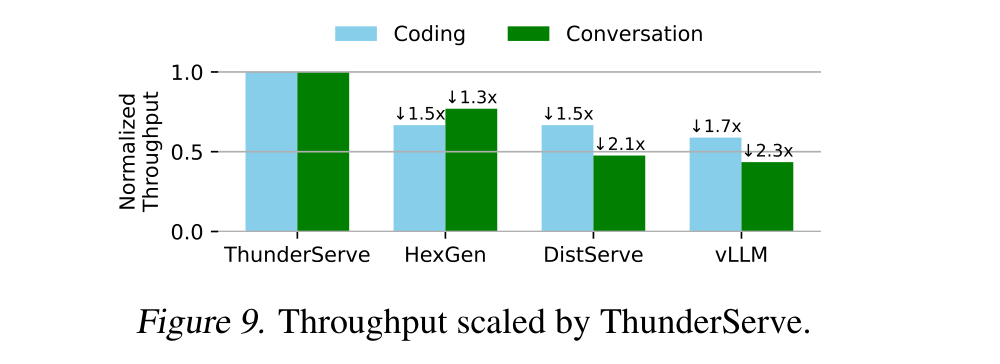

Fig. 9: Throughput scaled by ThunderServe

- Against HexGen: $1.5\times$ (coding) and $1.3\times$ (conversation) throughput.
- Against DistServe: $1.5\times$ (coding) and $2.1\times$ (conversation).

- Fig. 9 also reports $1.7\times$ / $2.3\times$ versus vLLM (coding / conversation).
- Fig. 9 normalizes ThunderServe to 1.0; its vLLM $2.3\times$ exceeds the abstract's stated $2.1\times$ maximum.

> Use baseline-specific ratios; the abstract and Fig. 9 do not state a consistent overall maximum.

---

<!-- _class: text-slide dense -->
<!-- SLIDE 36 -->

# Deployment Plans Found on the 32-GPU Cluster

ThunderServe / Experimental Results

|  | Coding | Conversation |
| --- | --- | --- |
| Prefill replicas | 8 | 4 |
| Decode replicas | 4 | 8 |
| Total phase replicas | 12 | 12 |

- Coding: 8 A40 GPUs form four prefill replicas, each with TP=2, PP=1.
- Conversation: 6 A40 GPUs form three prefill replicas; 2 A40 GPUs form one decode replica with TP=1, PP=2.
- A mixed replica uses 2 A5000 + 2 3090 Ti with TP=2, PP=2: TP stays within a GPU type, while PP connects stages.

> Replica count, phase and parallel configuration all respond to the workload.

Source: Table 3 and Appendix F. These are full deployment plans, not a phase-flip-only transition.

---

<!-- _class: long-table -->
<!-- SLIDE 37 -->

# Full Deployment Plans from Table 3

ThunderServe / Experimental Results

| Workload | GPUs | Strategy | Replicas |
| --- | --- | --- | --- |
| Coding | $8\times$A40 | TP=2, PP=1 | 4 prefill |
|  | $4\times$A5000 | TP=4, PP=1 | 1 prefill |
|  | $4\times$A6000 | TP=2, PP=1 | 2 prefill |
|  | $2\times$A5000+$2\times$ 3090Ti | TP=2, PP=2 | 1 prefill |
|  | $4\times$ 3090Ti | TP=2, PP=2 | 1 decode |
|  | $4\times$A6000 | TP=1, PP=2 | 2 decode |
|  | $2\times$A5000+$2\times$ 3090Ti | TP=2, PP=2 | 1 decode |
| Conversation | $6\times$A40 | TP=2, PP=1 | 3 prefill |
|  | $2\times$A5000+$2\times$ 3090Ti | TP=2, PP=2 | 1 prefill |
|  | $4\times$ 3090Ti | TP=2, PP=2 | 1 decode |
|  | $2\times$A40 | TP=1, PP=2 | 1 decode |
|  | $4\times$A5000 | TP=2, PP=2 | 1 decode |
|  | $8\times$A6000 | TP=1, PP=2 | 4 decode |
|  | $2\times$A5000+$2\times$ 3090Ti | TP=2, PP=2 | 1 decode |

> Coding is 8 prefill + 4 decode; conversation is 4 prefill + 8 decode. Both use 12 replicas.

Source: Table 3 and Appendix F. The previous slide highlighted only the A40 and one mixed row.

---

<!-- _class: figure-side -->
<!-- SLIDE 38 -->

# Tabu Search: Scheduling Convergence

ThunderServe / Experimental Results

- Scheduling from scratch is evaluated using 16, 24 and 32 GPUs.
- Approximate convergence times: 21, 36 and 54 seconds.
- The search runs once before initial model deployment.
- Scheduling time is small relative to the hourly scale of online services.

> Upper-level scheduling scales to the heterogeneous 32-GPU testbed.

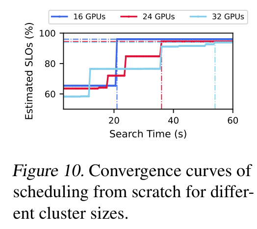

Fig. 10: Convergence under different GPU cluster sizes

---

<!-- _class: figure-side -->
<!-- SLIDE 39 -->

# Lightweight Re-scheduling after GPU Failures

ThunderServe / Experimental Results

- Test: one 4-A6000 instance goes offline, removing two decode replicas.
- Lightweight re-scheduling yields SLO attainment comparable to full re-scheduling.
- Table 4: full search $54(\pm5)$ s plus reload $103(\pm10)$ s, totaling $157(\pm13)$ s.
- Lightweight search $13(\pm2)$ s and reload $0$ s, so the whole step is $13(\pm2)$ s.

> Measured re-scheduling overhead is about $12\times$ lower; only weight reloading takes zero time.

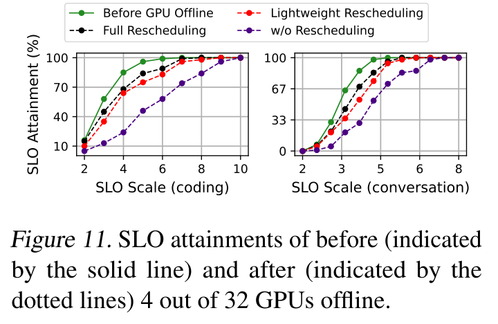

Fig. 11: SLO with 4 of 32 GPUs offline

---

<!-- _class: figure-side -->
<!-- SLIDE 40 -->

# Ablation: KV Cache Compression and Orchestration

ThunderServe / Experimental Results

- Without KV cache compression, paper reports roughly $1.3\times$ per-request overhead.
- Reduced communication efficiency weakens phase splitting benefits.
- Replacing the orchestration method with random dispatching causes further performance degradation.
- This removal is cumulative: random dispatch is tested with compression already disabled.

> The ablation supports both components; it does not isolate orchestration with compression enabled.

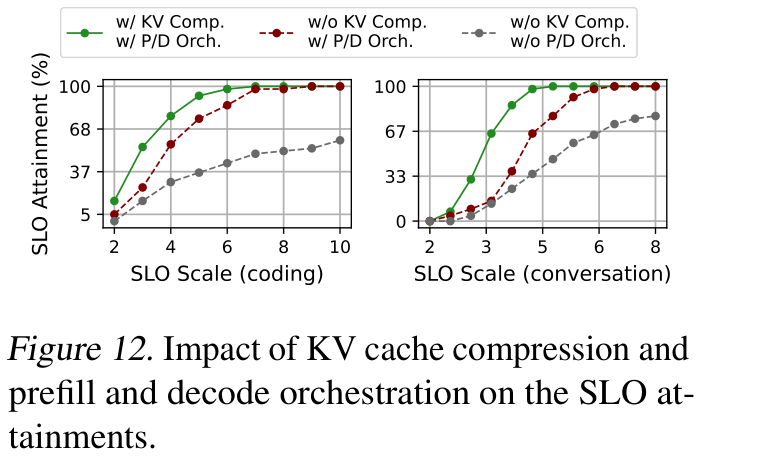

Fig. 12: Component ablations and SLO attainment

---

<!-- _class: figure-side -->
<!-- SLIDE 41 -->

# Simulator and Alpha-Beta Model Accuracy

ThunderServe / Experimental Results

- Appendix J uses LLaMA-30B micro-benchmarks.
- Vary SLO scales and batched token sizes.
- Left: simulated attainment differs from measurements by at most 2 percentage points in the plotted cases.
- Right: alpha-beta latency differs by at most 2 ms across the four plotted token sizes.

> These micro-benchmarks support the estimates in the tested settings; they are not a general error bound.

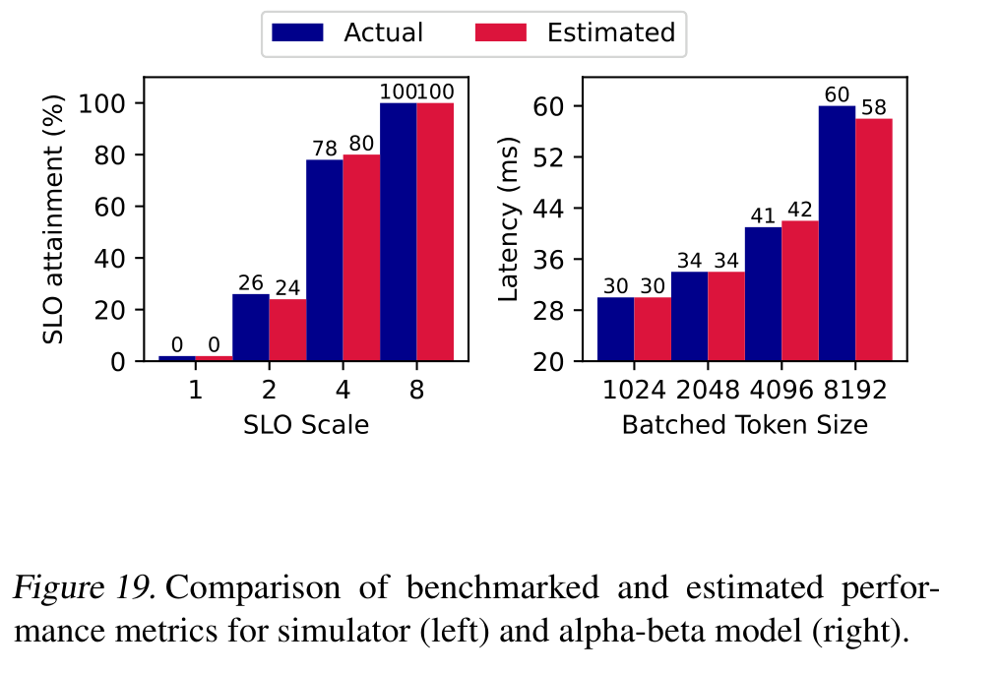

Fig. 19: Benchmarked vs. estimated performance

---

<!-- _class: text-slide -->
<!-- SLIDE 42 -->

# Discussion: Scope and Open Questions

ThunderServe / Discussion

- **Search quality:** tabu search and constrained TP / PP enumeration do not guarantee a globally optimal deployment.
- **Fast adaptation:** keeping groups and parallelism fixed reduces disruption, but cannot explore every plan after a workload shift.
- **Evidence scope:** main results use LLaMA-30B, two workload families and one 32-GPU cloud setup; broader models and network conditions need validation.
- **Reproducibility:** routing constraints and load dependence of pairwise scores need more detail than the printed formulation provides.

> Research question: when should a service pay for full re-planning instead of only changing phase roles?

Presenter analysis based on Sections 3 and 5; the final question is not an evaluated paper result.

---

<!-- _class: text-slide -->
<!-- SLIDE 43 -->

# ThunderServe: Contributions and Evaluation Findings

ThunderServe / Conclusion

SCHEDULING

## Two-level hierarchical optimization

Plan GPU groups, phase roles, TP / PP and request routing.

RUNTIME

## Lightweight re-scheduling

Adjust phases and orchestration without reloading model parameters.

COMMUNICATION

## KV cache compression

Quantize for inter-phase transfer; dequantize before decode computations.

SYSTEM

## Heterogeneous cloud serving

Combine TP / PP with phase splitting across heterogeneous cloud GPUs.

**Selected results:** vs. DistServe: $1.5\times$ / $2.1\times$ throughput (coding / conversation); cloud-vs-in-house E2E deadline ratio up to $2.5\times$.

> ThunderServe integrates phase splitting with heterogeneous cloud GPUs and network-aware scheduling.

Source: Sections 5.2 and 6; Fig. 9. Deadline ratios compare matched SLO attainment.

---

<!-- _class: closing -->
<!-- SLIDE 44 -->

# Questions & Discussion

## Phase splitting / Scheduling / KV transfer

ThunderServe: heterogeneous cloud serving
